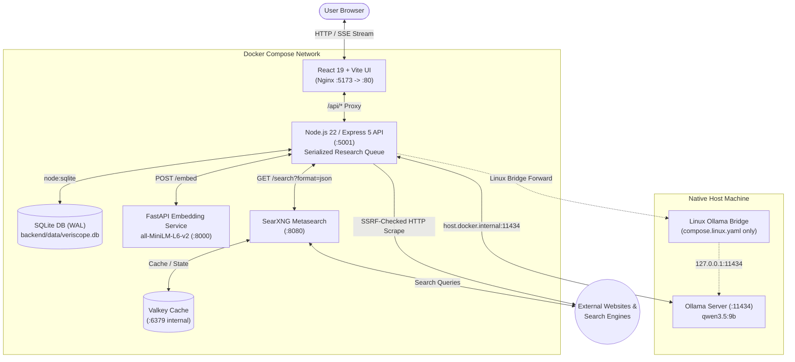
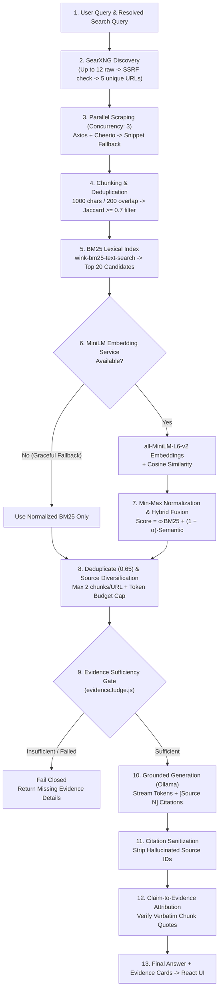
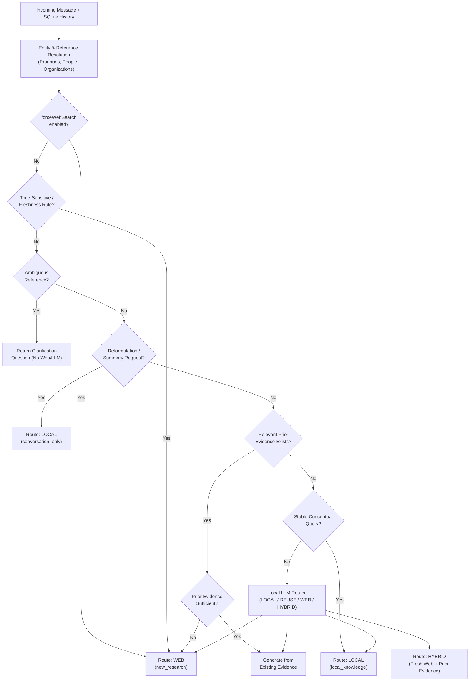
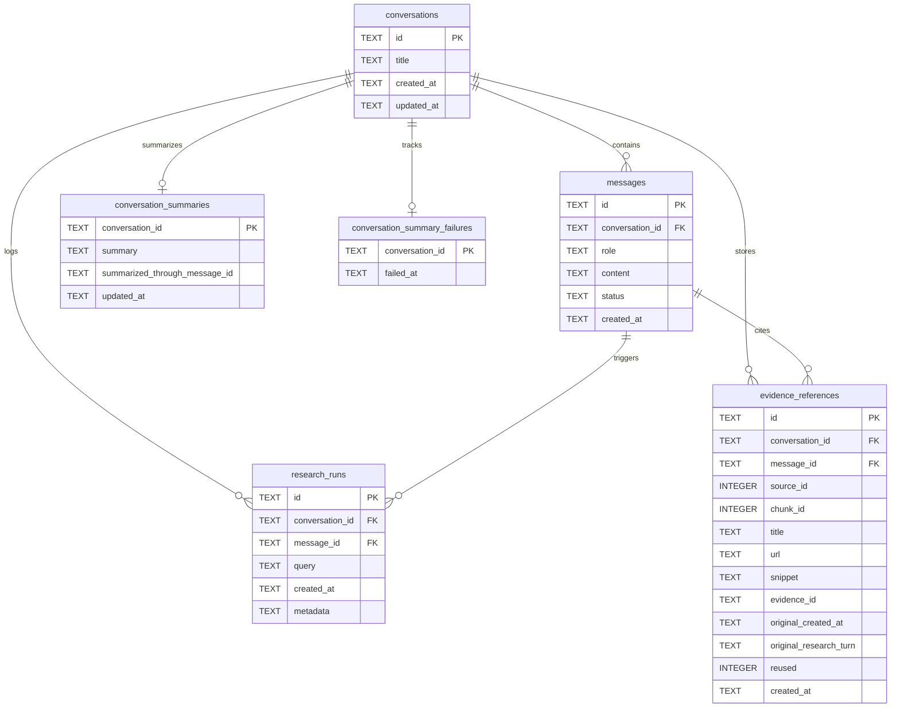

<div align="center">


<h1>VeriScope</h1>

<p><strong>Research you can verify. Intelligence you can run locally.</strong></p>

<p>
  VeriScope is a local-first AI deep research system that combines self-hosted web discovery,
  hybrid semantic and lexical retrieval, strict evidence-sufficiency gating, and local LLM inference
  to produce traceable, citation-grounded answers.
</p>

<p>
  
  
  
  
  
  
  
  
</p>

<p>
  <a href="#project-overview">Overview</a> •
  <a href="#key-features">Features</a> •
  <a href="#system-architecture">Architecture</a> •
  <a href="#research-pipeline">Pipeline</a> •
  <a href="#installation-and-setup">Setup</a> •
  <a href="#api-documentation">API</a> •
  <a href="#roadmap">Roadmap</a>
</p>

</div>

---

## Table of Contents

- [Project Overview](#project-overview)
- [Key Features](#key-features)
- [System Architecture](#system-architecture)
  - [A. High-Level System Architecture](#a-high-level-system-architecture)
  - [B. Detailed Research Pipeline](#b-detailed-research-pipeline)
  - [C. Query Routing and Follow-Up Workflow](#c-query-routing-and-follow-up-workflow)
  - [D. Data Persistence Architecture](#d-data-persistence-architecture)
- [Research Pipeline](#research-pipeline)
- [Technology Stack](#technology-stack)
- [Project Structure](#project-structure)
- [Installation and Setup](#installation-and-setup)
- [Configuration](#configuration)
- [API Documentation](#api-documentation)
- [Security and Privacy](#security-and-privacy)
- [Performance and Evaluation](#performance-and-evaluation)
- [Screenshots and Demonstration](#screenshots-and-demonstration)
- [Roadmap](#roadmap)
- [Contributing and License](#contributing-and-license)

---

## Project Overview

Conventional LLM interfaces blur the boundary between pretrained parametric memory and verified external facts. This creates five recurring failure modes in research workflows:

1. **Confident Hallucinations:** Models fabricate facts or citations when asked about recent events, software versions, or niche technical details.
2. **Opaque Provenance:** Answers rarely separate what was retrieved from what was inferred, making independent verification slow.
3. **Cloud Lock-In:** Sending research queries and conversation histories to third-party APIs introduces recurring costs and external data retention.
4. **Unvalidated Retrieval:** Standard RAG pipelines pass top-K chunks directly to generation even when those chunks do not actually answer the question.
5. **Broken Multi-Turn Context:** Follow-up questions either lose entity context or pollute new topics with stale sources from earlier turns.

**VeriScope** addresses these problems by treating the local language model (`qwen3.5:9b` via Ollama) as a **synthesis and evaluation engine—not the source of truth**:

- **Local-First Execution:** LLM inference, semantic embeddings (`all-MiniLM-L6-v2`), lexical indexing (BM25), and conversation storage (SQLite) run locally on your hardware.
- **Per-Turn Query Intelligence:** Deterministic rules and entity resolution decide whether a turn needs local knowledge, conversation reformulation, reuse of prior verified evidence, fresh web search, or a hybrid of both.
- **Fail-Closed Evidence Gating:** Before generating a grounded answer, an independent evaluator checks whether the retrieved passages explicitly support all parts of the query. If evidence is insufficient or verification fails, VeriScope refuses to guess.
- **Traceable Citations & Claim Attribution:** Generated answers enforce `[Source N]` citations, strip hallucinated source IDs, and map individual factual claims back to verbatim passages in the retrieved chunks.

---

## Key Features

### Implemented Capabilities

| Category | Feature | Implementation Details |
| :--- | :--- | :--- |
| **Local Inference** | **Ollama + Qwen 3.5 9B** | Local streaming inference (`stream: true`, `think: false`) with configurable context length (`4096` default), `keep_alive`, and dynamic output token budgeting. |
| **Web Discovery** | **Self-Hosted SearXNG** | Metasearch via local SearXNG JSON API backed by Valkey caching, URL normalization, and tracking-parameter stripping. |
| **Content Extraction** | **Parallel Scraping + Fallbacks** | Concurrent Axios + Cheerio extraction (max 3 concurrent, 5 pages, 6,000 chars/page) with SSRF protection, optional Playwright headless fallback, and SearXNG snippet fallback. |
| **Hybrid Retrieval** | **BM25 + MiniLM-L6-v2** | Lexical scoring via `wink-bm25-text-search` fused with cosine similarity from a local FastAPI `sentence-transformers` microservice. Gracefully falls back to BM25 if MiniLM is offline. |
| **Tunable Controls** | **Depth Presets & Alpha Slider** | UI controls for research depth (`FAST`, `NORMAL`, `MAX`), hybrid retrieval weight ($\alpha \in [0.1, 0.9]$), and forced web search (`Web: auto` / `Web: always`). |
| **Verification** | **Evidence Sufficiency Gate** | Strict JSON evaluator (`evidenceJudge.js`) that ignores pretrained knowledge and fails closed when passages are vague, partial, or off-topic. |
| **Grounding** | **Citation Sanitization & Claim Mapping** | Filters hallucinated `[Source N]` markers (`validateAndSanitizeCitations`) and maps factual claims to verbatim source quotes (`attributeClaims`). |
| **Multi-Turn Memory** | **Entity Resolution & Context Budgeting** | Resolves follow-up pronouns (`entityResolution.js`), maintains rolling SQLite conversation summaries, and fits history + evidence within the safe token budget. |
| **Persistence** | **SQLite (WAL Mode)** | Built-in `node:sqlite` (`DatabaseSync`) stores conversations, messages, research run metadata, evidence references, and summaries in `backend/data/veriscope.db`. |
| **Streaming UX** | **Server-Sent Events (SSE)** | Real-time pipeline progress (`status`), token streaming (`token`), clickable inline citation chips, collapsible evidence cards, and system health polling. |

---

## System Architecture

### A. High-Level System Architecture

VeriScope runs as a multi-service Docker Compose stack (or natively for development) communicating with a host-native Ollama instance. On Linux, `compose.linux.yaml` adds a loopback-preserving `ollama-bridge` bound strictly to the Docker bridge interface.



### B. Detailed Research Pipeline

When a query is routed to web or hybrid research, the backend executes a deterministic retrieval and verification pipeline before generating the final response.



### C. Query Routing and Follow-Up Workflow

Every turn passes through `decideResearchRoute` (`researchRouting.js`) and `resolveConversationEntities` (`entityResolution.js`) before deciding whether to invoke web retrieval.



### D. Data Persistence Architecture

Conversation state, evidence provenance, and rolling summaries are persisted locally in SQLite (`backend/data/veriscope.db`) with foreign-key cascading enabled.



---

## Research Pipeline

VeriScope executes the following stages during a web research turn:

1. **Query Reception & Serialization:** `POST /api/search` (or `POST /api/conversations/:conversationId/messages`) validates inputs and queues the request via `runSerializedResearch` so concurrent requests do not contend for local GPU/VRAM resources.
2. **Entity Resolution & Routing:** `entityResolution.js` and `researchRouting.js` resolve follow-up pronouns (e.g., *"he"*, *"that position"*) against completed exchanges and route the turn to `LOCAL`, `REUSE`, `WEB`, or `HYBRID`.
3. **Context Budgeting & Rolling Summaries:** `conversationContext.js` and `contextBudget.js` update a compact SQLite summary once completed messages pass `OLLAMA_SUMMARY_THRESHOLD_MESSAGES` (default `16`) and fit recent exchanges within `OLLAMA_CONTEXT_LENGTH` (`4096`) while reserving `OLLAMA_MIN_OUTPUT_TOKENS` (`696`) and a safety margin (`256`).
4. **Search Discovery & URL Filtering:** `searchEngine.js` queries SearXNG (`/search?format=json`), fetches up to 12 raw results, validates every URL against private/loopback IP ranges (`urlSafety.js`), strips tracking parameters (`utm_*`, `fbclid`, `gclid`, etc.), and keeps up to **5 unique URLs**.
5. **Web Extraction & Text Cleaning:** `scraper.js` fetches pages in parallel (concurrency limit `3`, max `6,000` characters per page) using Axios + Cheerio, stripping scripts, navigation, footers, ads, and cookie banners. If a page is blocked or unreadable, it falls back to the SearXNG search snippet. *(Playwright headless Chromium fallback is implemented in `scraper.js` and currently disabled by default in `research.js` to control latency.)*
6. **Chunking & Near-Duplicate Suppression:** `chunker.js` splits page text into `1,000`-character chunks with `200`-character overlap. `deduplicateChunks` removes exact duplicates and near-duplicates (Jaccard similarity $\ge 0.70$ or containment $\ge 0.85$).
7. **BM25 Lexical Retrieval:** `bm25.js` builds a per-query `wink-bm25-text-search` index (with a term-frequency fallback when fewer than 3 chunks exist) and selects the top **20** candidates.
8. **MiniLM Semantic Retrieval:** `embeddings.js` sends the query and top 20 candidate chunks to the local FastAPI `all-MiniLM-L6-v2` service and computes cosine similarity (`semanticsearch.js`). If the embedding service is offline, the pipeline logs a warning and degrades gracefully to BM25-only scoring.
9. **Hybrid Scoring:** Both BM25 and cosine similarity scores are min-max normalized to $[0, 1]$ (`normalize.js`) and combined using the user-configurable $\alpha$ parameter:

$$\text{Score} = \alpha \times \text{normalized\_BM25} + (1 - \alpha) \times \text{normalized\_semantic}$$

   - **$\alpha$ Control:** Users adjust $\alpha \in [0.1, 0.9]$ (default `0.5`) directly from the composer popover. Higher $\alpha$ prioritizes exact keyword matches (BM25); lower $\alpha$ prioritizes conceptual similarity (MiniLM).
   - *Note:* Normalized hybrid scores reflect relative ranking among retrieved chunks for a given query, not factual probability or confidence.
10. **Source Diversification & Token Budgeting:** `diversifySources` caps passages at **2 chunks per URL**, and `selectEvidenceWithinBudget` trims evidence to fit the selected depth preset (`FAST`: 5 chunks / 2,000 tokens; `NORMAL`: 10 chunks / 4,000 tokens; `MAX`: 20 chunks / 5,000 tokens) and remaining prompt budget.
11. **Evidence Sufficiency Gate:** `evidenceJudge.js` prompts the local model at `temperature: 0.0` to evaluate *only* the retrieved passages and return strict JSON (`sufficient`, `reason`, `missing`). If evidence is insufficient or the evaluator times out/returns malformed JSON, VeriScope **fails closed** and does not hallucinate an answer.
12. **Grounded Generation & Citation Validation:** `ollama.js` streams the grounded answer via SSE with strict `[Source N]` citation rules. `validateAndSanitizeCitations` strips any citation IDs that do not exist in the supplied evidence package.
13. **Claim-to-Evidence Attribution:** `evidenceAttribution.js` maps individual factual claims in the answer to exact contiguous quotes in the retrieved chunks (`direct`, `partial`, `related`, or `unsupported`), verifying every quote verbatim against the stored chunk text.

---

## Technology Stack

| Layer | Technology | Purpose | Role in VeriScope |
| :--- | :--- | :--- | :--- |
| **Frontend** | React 19, Vite 8 | UI & Build Tooling | Interactive research workspace, SSE token streaming, theme management, and responsive sidebar. |
| **Markdown** | `react-markdown`, `remark-gfm`, `rehype-highlight` | Safe Rendering | Renders GFM tables/code blocks without raw HTML execution; custom `remarkCitations` plugin turns `[Source N]` into clickable chips. |
| **Backend** | Node.js 22 (ESM), Express 5 | REST & SSE API | Orchestrates routing, scraping, retrieval, LLM calls, SSE streaming, and security headers. |
| **Local LLM** | Ollama (`qwen3.5:9b`) | Inference Engine | Runs per-turn routing, evidence sufficiency gating, grounded answer synthesis, claim attribution, and conversation summarization. |
| **Web Search** | SearXNG + Valkey 9 | Metasearch & Cache | Self-hosted web URL discovery via JSON API with persistent Valkey state. |
| **Scraping** | Axios, Cheerio, Playwright | Content Extraction | Fast static HTML extraction with SSRF protection (`urlSafety.js`) and optional headless browser fallback. |
| **Embeddings** | Python 3.11, FastAPI, `sentence-transformers` | Semantic Search | Local microservice running `all-MiniLM-L6-v2` on CPU (`POST /embed`). |
| **Lexical Search** | `wink-bm25-text-search` | Keyword Retrieval | In-memory BM25 scoring over extracted page chunks. |
| **Database** | SQLite (`node:sqlite`) | Local Persistence | WAL-mode relational storage for conversations, messages, evidence references, research runs, and summaries. |
| **Infrastructure** | Docker Compose, Nginx | Containerization | Orchestrates frontend (Nginx proxy), backend, SearXNG, Valkey, MiniLM, and Linux Ollama bridge. |

---

## Project Structure

```text
VeriScope/
├── backend/
│   ├── embedding-service/          # FastAPI + all-MiniLM-L6-v2 microservice
│   │   ├── app.py                  # / and /embed endpoints
│   │   ├── Dockerfile
│   │   └── requirements.txt
│   ├── src/
│   │   ├── llm/
│   │   │   ├── contextBudget.js        # Prompt/output token budget enforcement
│   │   │   ├── conversationContext.js  # Rolling summaries & history selection
│   │   │   ├── entityResolution.js     # Pronoun & entity resolution for follow-ups
│   │   │   ├── evidenceAttribution.js  # Verbatim claim-to-chunk quote mapping
│   │   │   ├── evidenceJudge.js        # Fail-closed evidence sufficiency evaluator
│   │   │   ├── ollama.js               # Grounded generation, direct answers & citation sanitization
│   │   │   ├── ollamaClient.js         # Env config, timeouts & error classification
│   │   │   ├── ollamaHealth.js         # Non-intrusive /api/tags & service health checks
│   │   │   └── researchRouting.js      # Deterministic + LLM per-turn query router
│   │   ├── retrieval/
│   │   │   ├── bm25.js                 # wink-bm25-text-search wrapper + small-corpus fallback
│   │   │   ├── chunker.js              # Overlapping text chunker
│   │   │   ├── deduplicate.js          # URL normalization, Jaccard chunk dedup & source diversity
│   │   │   ├── depth.js                # FAST/NORMAL/MAX presets & token estimation
│   │   │   ├── embeddings.js           # MiniLM client with BM25 fallback detection
│   │   │   ├── evidence.js             # Evidence package builder
│   │   │   ├── normalize.js            # Min-max score normalization
│   │   │   └── semanticsearch.js       # Cosine similarity
│   │   ├── routes/
│   │   │   └── search.js               # /api/search & /api/conversations/:id/messages (JSON/SSE)
│   │   ├── scraper/
│   │   │   ├── scraper.js              # Axios + Cheerio, Playwright & snippet fallback
│   │   │   ├── searchEngine.js         # SearXNG JSON discovery client
│   │   │   └── urlSafety.js            # SSRF protection (blocks private/loopback IPv4 & IPv6)
│   │   ├── conversationStore.js        # SQLite schema & transactional CRUD
│   │   ├── monitoring.js               # Ollama /api/ps, nvidia-smi & host RAM metrics
│   │   ├── ollamaBridge.js             # Linux Docker-bridge-only proxy to 127.0.0.1:11434
│   │   ├── research.js                 # Main end-to-end research pipeline orchestrator
│   │   └── server.js                   # Express app, security headers, CORS & routes
│   ├── test/                           # Node.js built-in test runner unit & API tests
│   ├── Dockerfile
│   └── package.json
├── frontend/
│   ├── public/favicon.svg              # VeriScope SVG mark
│   ├── src/
│   │   ├── components/                 # Composer, Sidebar, Message, Evidence, Markdown, StatusLine
│   │   ├── hooks/                      # useHealth, useTheme, usePersistentState, useMediaQuery
│   │   ├── lib/                        # citations.js, evidence.js, research.js, stream.js, format.js
│   │   ├── App.jsx                     # Main application shell & SSE stream state
│   │   └── conversationApi.js          # Backend API client
│   ├── Dockerfile
│   ├── nginx.conf                      # Reverse proxy for /api/ -> backend:5001
│   └── package.json
├── searxng/
│   └── settings.yml                    # SearXNG HTML + JSON format configuration
├── .env.example                        # Safe environment variable template
├── compose.yaml                        # Core Docker Compose stack
└── compose.linux.yaml                  # Linux override adding loopback-safe ollama-bridge
```

---

## Installation and Setup

### Prerequisites

- **Docker Engine / Docker Desktop** (with Docker Compose v2)
- **Ollama** installed natively on the host machine (deliberately not containerized to preserve direct GPU/Metal acceleration)
- **Node.js 22+** and **Python 3.11+** *(required only for native/manual development; not needed for Docker Compose)*

### 1. Clone the Repository

```bash
git clone [https://github.com/adeebkhan14/VeriScope-A-Local-First-Evidence-Grounded-Deep-Research-System.git](https://github.com/adeebkhan14/VeriScope-A-Local-First-Evidence-Grounded-Deep-Research-System.git)
cd VeriScope-A-Local-First-Evidence-Grounded-Deep-Research-System
```

### 2. Install Ollama and Pull the Default Model

Install Ollama from [ollama.com](https://ollama.com), then pull `qwen3.5:9b`:

```bash
ollama pull qwen3.5:9b
ollama list
```

### 3. Configure Environment Variables

Copy `.env.example` to `.env` and generate a unique `SEARXNG_SECRET`:

**Linux / macOS:**
```bash
cp .env.example .env
sed -i.bak "s/^SEARXNG_SECRET=.*/SEARXNG_SECRET=$(openssl rand -hex 32)/" .env && rm -f .env.bak
```

**Windows (PowerShell):**
```powershell
Copy-Item .env.example .env
$bytes = New-Object byte[] 32
[System.Security.Cryptography.RandomNumberGenerator]::Create().GetBytes($bytes)
$secret = ($bytes | ForEach-Object { $_.ToString('x2') }) -join ''
(Get-Content .env) -replace '^SEARXNG_SECRET=.*', "SEARXNG_SECRET=$secret" | Set-Content .env
```

### 4. Start VeriScope with Docker Compose (Recommended)

**macOS / Windows (Docker Desktop):**
```bash
docker compose up --build -d
```

**Linux (with loopback-preserving Ollama bridge):**
```bash
docker compose -f compose.yaml -f compose.linux.yaml up --build -d
```

> **Note:** On the first run, the `embedding` container downloads `all-MiniLM-L6-v2` weights and may take a few minutes to become healthy. The SQLite database (`backend/data/veriscope.db`) is initialized automatically on backend startup.

Open **http://localhost:5173** in your browser.

### 5. Native / Manual Development Setup

If you prefer running the frontend and backend natively while keeping SearXNG and MiniLM in Docker:

```bash
# 1. Start SearXNG (with Valkey) and MiniLM in Docker
docker compose up -d --build searxng embedding

# 2. Terminal 1 — Start Backend (Node.js 22+)
cd backend
npm ci
npm run dev

# 3. Terminal 2 — Start Frontend
cd frontend
npm ci
npm run dev
```

*(Optional)* To run the MiniLM embedding service natively without Docker:
```bash
python3 -m venv backend/embedding-service/venv
source backend/embedding-service/venv/bin/activate   # Windows: .\backend\embedding-service\venv\Scripts\Activate.ps1
pip install -r backend/embedding-service/requirements.txt
cd backend/embedding-service
uvicorn app:app --host 127.0.0.1 --port 8000
```

### 6. Run Backend Tests

```bash
cd backend
npm test
```

---

## Configuration

All environment variables are loaded from the root `.env` file (via `node --env-file-if-exists=../.env` or Docker Compose).

| Variable | Purpose | Required | Default |
| :--- | :--- | :---: | :--- |
| `SEARXNG_SECRET` | Secret key required by the SearXNG container | **Yes** | *(none — must be generated)* |
| `PORT` | Express backend HTTP port | No | `5001` |
| `CORS_ORIGINS` | Comma-separated allowed frontend origins | No | Permissive in native dev; `http://localhost:5173,http://127.0.0.1:5173` in Compose |
| `OLLAMA_BASE_URL` / `OLLAMA_URL` | Ollama API base URL (`OLLAMA_URL` is a legacy alias) | No | `http://localhost:11434` (native) / `http://host.docker.internal:11434` (container) |
| `OLLAMA_MODEL` | Local Ollama model name | No | `qwen3.5:9b` |
| `OLLAMA_KEEP_ALIVE` | Duration Ollama keeps the model loaded in memory | No | `30m` |
| `OLLAMA_CONTEXT_LENGTH` | Total context window (`num_ctx`) | No | `4096` |
| `OLLAMA_NUM_PREDICT` | Maximum generated output tokens (`num_predict`) | No | `2048` |
| `OLLAMA_TEMPERATURE` | Sampling temperature (`0`–`2`) | No | `0.3` (native) / `0.15` (Compose) |
| `OLLAMA_REQUEST_TIMEOUT_MS` | Timeout for Ollama inference calls (ms) | No | `300000` |
| `OLLAMA_HISTORY_TOKEN_BUDGET` | Max tokens allocated to conversation history | No | `1600` |
| `OLLAMA_RECENT_EXCHANGES` | Number of recent Q&A pairs retained verbatim | No | `5` |
| `OLLAMA_SUMMARY_THRESHOLD_MESSAGES` | Message count before rolling summarization activates | No | `16` |
| `OLLAMA_SUMMARY_MIN_NEW_MESSAGES` | Minimum new older messages to trigger summary update | No | `6` |
| `OLLAMA_SUMMARY_TOKEN_BUDGET` | Max token budget for stored conversation summary | No | `500` |
| `OLLAMA_HISTORICAL_EVIDENCE_TOKEN_BUDGET` | Max tokens for historical evidence excerpts | No | `300` |
| `OLLAMA_MIN_OUTPUT_TOKENS` | Minimum output tokens reserved before truncating prompt | No | `696` |
| `OLLAMA_CONTEXT_SAFETY_MARGIN` | Safety buffer subtracted from `OLLAMA_CONTEXT_LENGTH` | No | `256` |
| `SEARXNG_URL` / `DOCKER_SEARXNG_URL` | SearXNG base URL (native / container) | No | `http://localhost:8080` / `http://searxng:8080` |
| `SEARXNG_HOST_BIND` / `SEARXNG_PORT` | Host bind interface and port for SearXNG | No | `127.0.0.1` / `8080` |
| `EMBEDDING_URL` / `DOCKER_EMBEDDING_URL` | MiniLM `/embed` endpoint (native / container) | No | `http://127.0.0.1:8000/embed` / `http://embedding:8000/embed` |
| `EVIDENCE_JUDGE_TIMEOUT_MS` | Timeout for the evidence sufficiency gate (ms) | No | `60000` (native) / `180000` (Compose) |
| `CLAIM_ATTRIBUTION_TIMEOUT_MS` | Timeout for claim-to-evidence attribution (ms) | No | `15000` |
| `RESEARCH_{FAST,NORMAL,MAX}_TOP_K` | Max evidence chunks per depth preset | No | `5` / `10` / `20` |
| `RESEARCH_{FAST,NORMAL,MAX}_EVIDENCE_TOKEN_BUDGET` | Evidence token budget per depth preset | No | `2000` / `4000` / `5000` |
| `VERISCOPE_DEBUG_CONTEXT` | Log prompt token allocation diagnostics (non-prod) | No | `false` |

---

## API Documentation

The Express backend exposes REST and Server-Sent Events (SSE) endpoints on port `5001` (proxied at `/api/*` by Vite in dev and Nginx in Docker). Request bodies are capped at `1 MB`.

| Method | Endpoint | Purpose |
| :--- | :--- | :--- |
| `GET` | `/` | Basic API liveness check (`{ name, status }`). |
| `GET` | `/api/health` | Checks connectivity to Ollama (`/api/tags`), SearXNG, and MiniLM without loading the model. |
| `GET` | `/api/monitoring` | Returns Ollama model allocation (`/api/ps`), NVIDIA GPU metrics (`nvidia-smi`), host RAM, and last research metrics. |
| `POST` | `/api/search` | Starts a research query (creates a conversation automatically if `sessionId` is omitted). Supports JSON or SSE. |
| `GET` | `/api/conversations` | Lists all conversations ordered by `updated_at DESC` with message counts. |
| `POST` | `/api/conversations` | Creates a new conversation (optionally accepting `title` or an initial `message`). |
| `GET` | `/api/conversations/:conversationId` | Returns a conversation with its ordered `messages`, `evidenceReferences`, and `researchRuns`. |
| `DELETE` | `/api/conversations/:conversationId` | Deletes a conversation and cascades to messages, evidence, and summaries. |
| `POST` | `/api/conversations/:conversationId/messages` | Sends a follow-up query within an existing conversation. Supports JSON or SSE. |

<details>
<summary><strong>Example Requests, Responses & Error Codes</strong></summary>

#### `POST /api/search` (JSON)
```bash
curl -X POST http://localhost:5001/api/search \
  -H "Content-Type: application/json" \
  -d '{
    "query": "How does Kubernetes perform service discovery?",
    "depth": "NORMAL",
    "alpha": 0.5,
    "forceWebSearch": false
  }'
```

**Request Body Parameters:**
- `query` *(string, required)*: Non-empty research question (also accepts `content` or `message`).
- `depth` *(string, optional)*: `"FAST"`, `"NORMAL"` (default), or `"MAX"`.
- `alpha` *(number, optional)*: Hybrid weight between `0` and `1` (default `0.5`).
- `forceWebSearch` *(boolean, optional)*: Bypass local routing and always search the web (default `false`).
- `sessionId` *(string, optional)*: Existing or client-generated conversation ID (max 128 chars).
- `stream` *(boolean, optional)*: Set `true` or send `Accept: text/event-stream` for SSE streaming.

**SSE Events (`Accept: text/event-stream`):**
- `event: status` → `{"message": "Scraping 5 pages..."}`
- `event: token` → `{"text": "Kubernetes uses..."}`
- `event: done` → `{"result": { "query", "answer", "citations", "evidence", "claimAttribution", "insufficientEvidence", "source", "researchMetadata", "conversationId", "userMessageId", "assistantMessageId" }}`
- `event: error` → `{"error": "...", "code": "...", "service": "..."}`

**Error Responses:**
- `400 Bad Request`: Missing/empty query, invalid `depth`, out-of-range `alpha`, or malformed JSON.
- `404 Not Found`: Unknown `:conversationId`.
- `413 Payload Too Large`: Request body > 1 MB or prompt exceeds safe `OLLAMA_CONTEXT_LENGTH` (`CONTEXT_BUDGET_EXCEEDED`).
- `502 Bad Gateway`: Upstream SearXNG or Ollama returned an invalid/failed response.
- `503 Service Unavailable`: SearXNG or Ollama is unreachable.
- `504 Gateway Timeout`: Upstream search or inference timed out.

</details>

---

## Security and Privacy

VeriScope is designed to keep inference and storage local while being transparent about external network boundaries:

- **What Stays Local:**
  - All LLM inference (routing, evidence judging, answer synthesis, claim attribution, summarization) runs locally via Ollama.
  - Semantic embeddings (`all-MiniLM-L6-v2`) and BM25 indexing run locally.
  - Conversations, messages, and evidence excerpts are stored locally in `backend/data/veriscope.db` (unencrypted SQLite on disk).
  - The frontend renders Markdown without `rehype-raw` and suppresses remote images so model output cannot execute HTML or trigger third-party image requests.
- **What Communicates Externally:**
  - When a query routes to `WEB` or `HYBRID`, SearXNG sends the resolved search query to configured external search engines.
  - The backend scraper issues direct HTTP/HTTPS GET requests to discovered public web pages.
- **Built-In Protections:**
  - **SSRF Defense (`urlSafety.js`):** Blocks non-HTTP(S) schemes, URLs with embedded credentials, and DNS/IP resolutions pointing to loopback, private, link-local, or multicast IPv4/IPv6 ranges.
  - **HTTP Hardening (`server.js`):** Sets `X-Content-Type-Options: nosniff`, `X-Frame-Options: DENY`, `Referrer-Policy: no-referrer`, disables `X-Powered-By`, attaches `X-Request-ID`, and supports `CORS_ORIGINS` allowlisting.
  - **Linux Bridge Isolation (`ollamaBridge.js`):** Refuses to bind unless the resolved IPv4 address belongs to a Docker bridge interface (`docker0` / `br-*`), keeping host Ollama on `127.0.0.1`.

---

## Performance and Evaluation

No formal benchmark results are checked into this repository yet. End-to-end latency varies significantly with local hardware (GPU VRAM vs. CPU/unified memory offload), `OLLAMA_CONTEXT_LENGTH`, and target website response times. You can inspect live hardware allocation and the latest run's timing (`retrievalTimeMs`, `timeToFirstTokenMs`, `generationTimeMs`) via `GET /api/monitoring`.

### Evaluation Roadmap

Proposed metrics for a future reproducible evaluation suite:

- **Retrieval Quality:** Precision@K and Recall@K across BM25-only, MiniLM-only, and hybrid $\alpha$ configurations.
- **Citation Accuracy:** Rate of valid, verifiable `[Source N]` citations vs. stripped/hallucinated markers.
- **Answer Faithfulness:** Claim-level verification rate (`direct` / `partial` vs. `unsupported` claims from `evidenceAttribution.js`).
- **Evidence Sufficiency Accuracy:** False-positive and false-negative rates of `evidenceJudge.js` on unanswerable and multi-part queries.
- **Query Routing Accuracy:** Classification precision across `LOCAL`, `REUSE`, `WEB`, `HYBRID`, and `ambiguous` turns.
- **Latency & Resource Consumption:** Per-stage timing breakdown (SearXNG, scraping, embedding, judging, TTFT, generation) alongside VRAM/RAM usage.

---

## Screenshots and Demonstration

No screenshots or demo recordings are currently included in the repository.

To add visual assets, create a `docs/screenshots/` directory and link them using relative paths:

```text
docs/
└── screenshots/
    ├── workspace-dark.png      # Main research interface with inline citation chips
    ├── evidence-drawer.png     # Expanded evidence cards with hybrid relevance scores
    └── composer-controls.png   # Depth presets, alpha slider, and Web: auto/always toggle
```

---

## Roadmap

### Completed
- [x] Local-first Docker Compose stack (React/Nginx, Express, SearXNG, Valkey, FastAPI MiniLM) + Linux loopback-safe Ollama bridge
- [x] Hybrid BM25 + `all-MiniLM-L6-v2` retrieval with configurable $\alpha$ and graceful BM25 fallback
- [x] Research depth presets (`FAST`, `NORMAL`, `MAX`) with token-budgeted evidence selection
- [x] Fail-closed evidence sufficiency gate (`evidenceJudge.js`)
- [x] Citation sanitization (`validateAndSanitizeCitations`) and verbatim claim-to-evidence attribution (`evidenceAttribution.js`)
- [x] Per-turn query routing, pronoun/entity resolution, and SQLite conversation persistence with rolling summaries
- [x] SSE streaming frontend with clickable citation chips, collapsible evidence cards, and live health status

### Planned
- [ ] Contradiction detection across conflicting web sources
- [ ] Local document research (PDF, Markdown, and text ingestion)
- [ ] Encrypted SQLite conversation storage
- [ ] Research report export (Markdown / PDF)
- [ ] Automated evaluation suite and stage-by-stage latency benchmarks
- [ ] Embedding cache to avoid recomputing unchanged webpage chunks

---

## Contributing and License

### Contributing

Contributions, bug reports, and architecture improvements are welcome.

1. Fork the repository and create a feature branch (`git checkout -b feat/your-feature`).
2. Run the backend test suite (`cd backend && npm test`) and frontend linter (`cd frontend && npm run lint`) before submitting.
3. Open a Pull Request describing the problem, your changes, and how you verified them.

For bug reports, please include your OS, Docker/Node versions, `OLLAMA_MODEL`, and the output of `GET /api/health` (with any sensitive values removed).

### License

No `LICENSE` file is currently present in the repository root *(the `backend/package.json` metadata lists `ISC`, while no root project license has been formally specified)*. Please add a `LICENSE` file to define redistribution and usage terms.